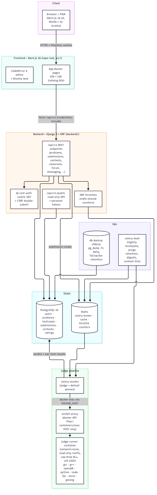
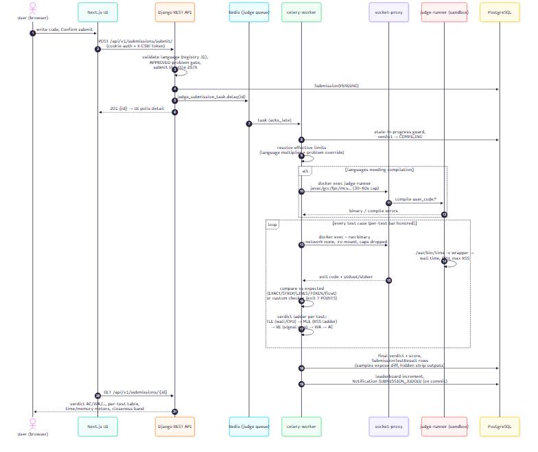
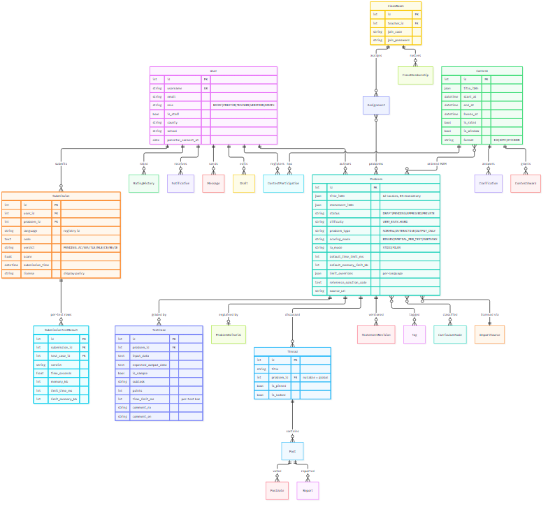
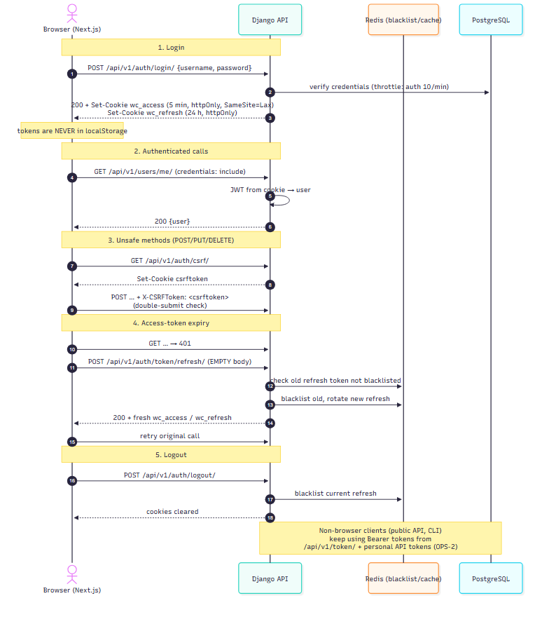
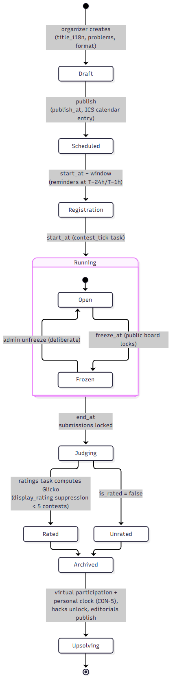

# WebCoder — System Architecture

> One-paragraph summary: WebCoder is a bilingual (RO/EN + 10 more UI locales) competitive-programming platform — a Next.js 16 front end over a Django 6 / DRF API, a Celery-driven judge that executes untrusted code inside a hardened Docker sandbox through a filtering socket proxy, and a Postgres+Redis state layer. This guide is for engineers who need to understand, run, or extend the system; each section maps to code you can open today.

**Who it's for:** backend/frontend contributors, operators deploying the stack, and anyone evaluating the platform's design. The Romanian twin of this guide is [`docs/guide-ro/ARHITECTURA.md`](../guide-ro/ARHITECTURA.md).

---

## 1. Component map



*Source: [`docs/diagrams/component-map.mmd`](../diagrams/component-map.mmd)*

| Component | Where | Responsibility |
|---|---|---|
| Next.js 16 app | repo root `src/`, App Router | SSR/ISR pages, CodeMirror/Blockly editors, RO/EN UI with i18next + 12-locale problem fields |
| Django 6 + DRF | `backend/` (~25 apps) | `/api/v1` REST: problems, submissions, contests, ratings, classroom, forum, messaging, translations, public API |
| PostgreSQL 16 | compose `postgres` | system of record (no host port published) |
| Redis | compose `redis` | celery broker, throttle cache, judge queue |
| celery-worker | compose `celery-worker` | judge + default queues; `acks_late` with stale-in-progress guard |
| judge-runner | `backend/Dockerfile.judge` | sandboxed toolchains: gcc/g++, OpenJDK, CPython, Node, fpc, mono, golang |
| socket-proxy | compose overlay default | docker API filter — containers/exec POST only; everything else 403 |
| celery-beat | compose `celery-beat` | nightly leaderboard recompute, notification purge, output retention, weekly digest, per-minute `contest-tick` |
| db-backup | compose sidecar | daily `pg_dump -Fc`, 7d/4w/6m retention |

Frontend–backend contract: cookies travel with `credentials: 'include'`; the catalog list is ISR-cached 60 s server-side (disabled under `E2E_API_BASE`).

## 2. The judge pipeline



*Source: [`docs/diagrams/judge-pipeline.mmd`](../diagrams/judge-pipeline.mmd)*

Key invariants (all enforced in code, `backend/submissions/`):

1. **Language registry** (`submissions/judge_utils/languages.py`) is the single source of truth — compile/run commands, per-language time multipliers (e.g. python ×3), memory floors, toolchain pins mirrored on `/api/v1/public/languages/`.
2. **Every judged run** is `--network none` with a read-only submission mount, all capabilities dropped, uid 1000 (`backend/judge_utils/`, `Dockerfile.judge`).
3. **Verdict ladder** per test: TLE (wall vs CPU), MLE (max-RSS ladder incl. exit-137 + ≥0.9×limit), RE (signal-mapped messages), WA, AC — fabrication triggers were deleted in the judge-fairness wave.
4. **Comparison modes**: EXACT / STRIP / LINES_STRIP / TOKEN / float-epsilon (`problems/models.Problem.ComparisonMode`), plus custom checkers speaking the exit-7 `POINTS <0..1>` partial protocol (testlib-compatible).
5. **Scoring modes**: BINARY, PARTIAL_PER_TEST, SUBTASKS (DMOJ all-members rule).
6. **Feedback gating**: sample tests expose input+expected for diffing; hidden tests strip outputs for non-privileged viewers; per-test time/memory bars are persisted on every result row.
7. **Custom libraries**: pip install happens in a one-shot container on an internal `judge-build` network whose only egress is a pre-seeded pypi allowlist proxy — fail-closed by default (RUNBOOK §judge-pip-egress).

## 3. Data model (core slice)



*Source: [`docs/diagrams/data-model.mmd`](../diagrams/data-model.mmd)*

Modeling notes:

- Localized fields are JSON objects keyed by locale with **English mandatory** (`problems/i18n_fields.py` owner rule (b)); RO is the home-market language; the i18n-10 wave added 10 more UI locales for statements/titles.
- `Submission` → `SubmissionTestResult` carries per-test verdict, time, memory, **and the applied limits** (judge-fairness receipts).
- `Problem.reference_solution_code` powers hack counter-tests, testcase-strength scoring and the hidden-suite generator (`boost_hidden_tests`).
- Import provenance (`source_url`, `source_authors`, `ImportSource` ledger) records where content came from and under what terms (CNT-2).

## 4. Auth & cookie flow



*Source: [`docs/diagrams/auth-cookie-flow.mmd`](../diagrams/auth-cookie-flow.mmd)*

- `wc_access` (5 min) + `wc_refresh` (24 h) are **httpOnly cookies** — never in `localStorage`; rotation blacklists the old refresh (`backend/users/`, dj-rest-auth).
- Unsafe methods require the double-submit `X-CSRFToken` (cookie via `GET /api/v1/auth/csrf/`).
- Non-browser clients use Bearer tokens and personal API tokens (public API, 60/min; tokened 240/min).
- Roles: BASIC, CREATOR, TEACHER, VERIFIER, ADMIN (`users/models.Roles`); minors' profiles default non-public (LEG-2).

## 5. Contest lifecycle



*Source: [`docs/diagrams/contest-lifecycle.mmd`](../diagrams/contest-lifecycle.mmd)*

- `contest_tick` (beat, every minute) drives state transitions; formats are strategy classes (IOI sum-of-best is the default; ICPC penalty and AtCoder-style exist).
- Freeze is a query filter on the scoreboard; ratings commit post-contest via Glicko with AtCoder-style display suppression for newcomers.
- Upsolving/virtual participation re-opens problems under a personal clock; hacks unlock after a full board solve.

## 6. Cross-cutting mechanics

- **Pagination**: every list endpoint uses standard/cursor pagination (`webcoder_api/pagination.py`).
- **Throttles**: anon 60/min, user 240/min, scoped `auth` 10/min, `submit` 20/h, scratch/guest/sample-run scopes; counters in redis (shared across processes).
- **Observability**: `/healthz`, `/readyz` (db+cache+broker), admin metrics snapshot, JSON logs (`LOG_JSON=1`).
- **Reproducibility**: `export_catalog` / `import_catalog` (+ release-asset snapshot) rebuild the imported catalog deterministically; `seed_problems` rebuilds the starter pack; `boost_hidden_tests` regenerates hidden suites from committed specs.
- **Testing**: pytest (sqlite CI profile, 100 % line coverage, zero warnings), vitest, Playwright mock-mode + real-stack mode (`E2E_API_BASE`).

## 7. Repository layout

```text
backend/<app>/         Django apps (problems, submissions, contests, ratings,
                       classroom, forum, messaging, translations, …)
backend/problems/data/ committed content specs + catalog tooling fixtures
docs/                  this documentation suite (EN/RO guides, dist/)
e2e/                   Playwright specs (mock-api + real-stack) & fixtures
mobile/                PWA shell (service worker, offline packs)
scripts/               ops scripts (load smoke, autoscale, restore drill)
src/                   Next.js 16 app (App Router)
docker-compose*.yml    Mode-A stack + overlays (socket-proxy, custom-libs)
```

## 8. Further reading

- RUNBOOK (`docs/RUNBOOK.md`) — env vars, live stack, backups, e2e modes
- SECURITY (`docs/SECURITY.md` / guide) — sandbox receipts, throttles, reporting
- CONTRIBUTING — gates, PR conventions, the wave workflow
- BLOCK-PROGRAMMING — the Blockly lane and partial-code problems
