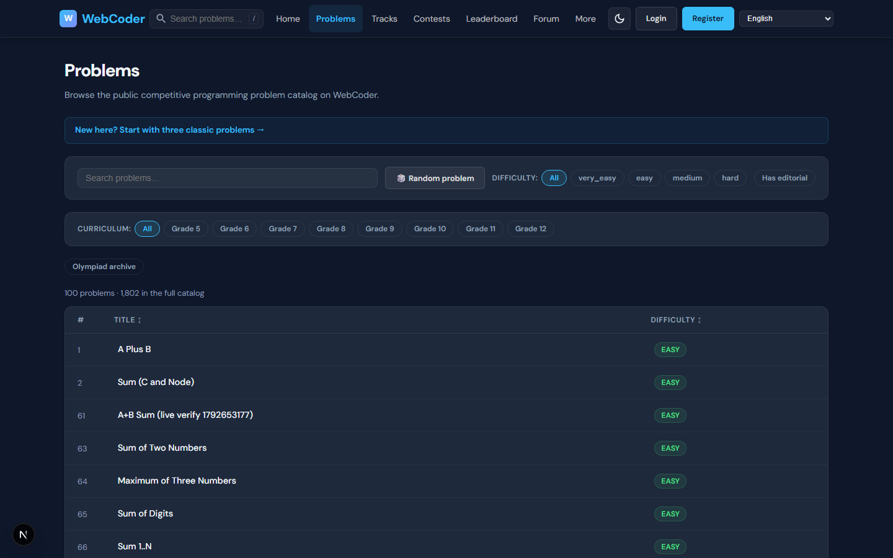
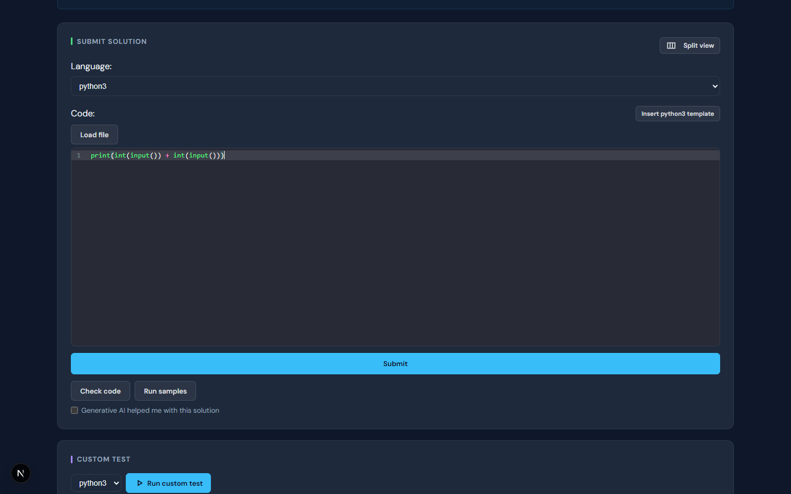
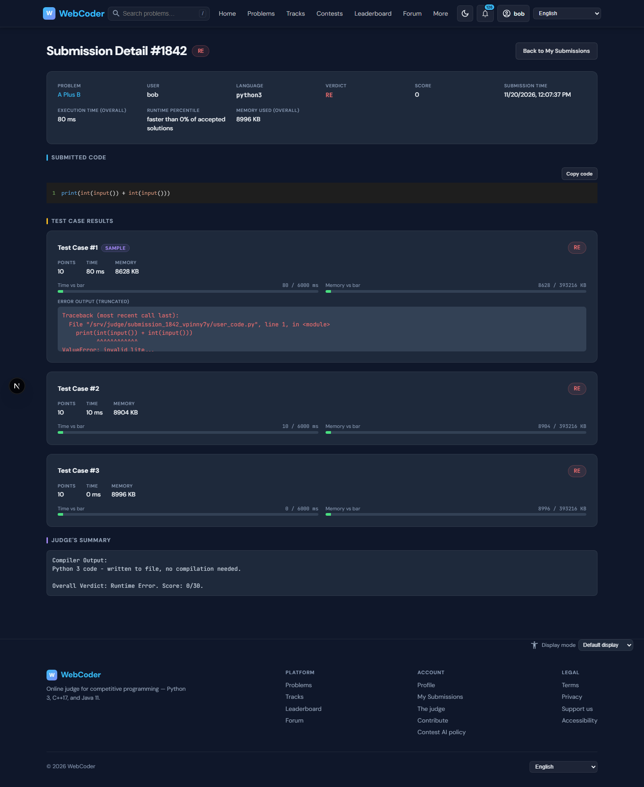

# WebCoder — User Guide (learners)

> One-paragraph summary: WebCoder is a bilingual (Romanian/English, plus 10 more interface languages) competitive-programming platform: browse ~1 800 problems mapped on the national curriculum, solve them in a real code editor with instant judged verdicts, join rated contests, climb the rating ladder, learn from hints and editorials, and — with a teacher — do all of it as classroom homework. This guide walks every learner flow end to end.

**Who it's for:** students, contest participants, self-learners. Romanian twin: [`docs/guide-ro/GHID-UTILIZATOR.md`](../guide-ro/GHID-UTILIZATOR.md).

---

## 1. Create an account

1. Open the site and press **Sign up**.
2. Choose a username and password (email optional unless your teacher requires verification; Google / GitHub / Microsoft school login also work).
3. That's it — you land on the home page with the catalog, contests and learning hub one click away.

Under-16 accounts (GDPR Art. 8): profiles stay non-public and school/county fields hidden until parental consent is recorded; classroom accounts can be school-mediated instead.

## 2. Find a problem

The **Problems** catalog (`/problems`) is the main surface:

- filter by difficulty (very easy → hard), tag, curriculum chapter (grades 5–12 tree), source archive, I/O mode, solved-status;
- the **Ctrl-K palette** searches problems, threads, articles, contests and users from anywhere;
- the dice button picks a random problem matching your filters;
- the catalog shows solve counters and your solved/attempted marks.

Curriculum view: pick your grade → chapter → topic; every node lists its problems (pbinfo-style navigation, bilingual).

## 3. Read, solve, submit

A problem page has the statement (Markdown + LaTeX math), limits, samples with copy buttons and localized sample comments, hints, and the editor.

1. Pick a language — C, C++, Python 3, Java, JavaScript, Go, C#, Pascal (per-problem allowlists may apply).
2. Write code in the CodeMirror editor (Tab indents, Ctrl+Enter submits; your draft autosaves per problem and follows you across devices).
3. Optional before submitting: **Custom test** (run on your own input), **Run samples** (compile once, judge every sample with mismatch hints), the pre-submit **lint** (bilingual pitfall warnings), and the **stress runner** for authors.
4. Press **Submit** and confirm — the verdict page polls the judge and shows the per-test table, time/memory meters against the actual bars, and the "how close am I?" band.

 

Verdicts: **AC** (accepted), **WA** (wrong answer — sample tests show an expected-vs-actual diff), **TLE/MLE** (time/memory, with the limit that was applied), **RE** (runtime error, signal-mapped), **CE** (compile error, with plain-language hints). Partial scoring is per test or per subtask, depending on the problem.

After an AC: the editorial unlocks (if gated), the solutions pool lets you compare your code with the fastest/shortest accepted solutions, and you can share a solve card.

## 4. Learn, don't just score

- **Hints** — progressive, per problem; the weekly digest emails your attempted-but-unsolved problems with their first hint.
- **Editorials** — unlock on your own AC by default (peeking marks the solve as "with editorial").
- **/learning hub** — spaced-repeat review queue over your misses, skill graph, theory cards, mistake-pattern profile, a generated weekly practice plan.
- **/drills** — a daily warm-up set (read-the-code, fill-the-line, complexity drills).
- **/visualizers** — step-frame animations of sorting and binary search.
- **/courses** — structured lessons (e.g. the Scratch→Python bridge).
- **/start** — the guided first-solve ladder + onboarding checklist.

## 5. Contests and ratings

- `/contests` lists upcoming (with countdown + ICS calendar subscription), running, and past contests; register in one click.
- Formats include IOI-style (sum of best per problem), ICPC penalty, windowed personal-timer contests for classrooms, team contests, school cups and long challenges.
- During a contest: live scoreboard (frozen near the end), clarification queue to the jury, self-prediction of your final rank.
- After: Glicko rating updates with color bands and divisions (promotions/demotion events annotated on your rating graph), medals, replay of any participant's timeline, and upsolving on the archive with full feedback.
- Integrity: AI-assistance declarations, multi-account detection, plagiarism scans — rated contests assume unaided work (see the RO/EN contest rules page).

## 6. Community

- **Forum** with per-problem discussion threads (spoiler-flagged inside problem threads), wiki, blogs, articles hub.
- **Messaging** — private 1:1 threads with reporting, block and rate protections.
- **Community hub** (`/amas`): reputation tiers, awards, medalist AMAs, problem-request board.
- Report buttons everywhere feed the moderation queue (SLA-tracked).

## 7. Profile & settings

`/profile` shows stats, the 90-day heatmap, streaks (weekly-target framing), per-tag skill bars, rating graphs with annotations, badges, certificates (atestats with public verification UUIDs) and your mistake-pattern profile. Settings: display name/bio, county/school (segmented leaderboards), timezone (contest times render in your zone), notification digest frequency, a11y display modes (dyslexia-friendly, high-contrast), dark/light theme.

## 8. Mobile & offline

The PWA installs on phones; offline statement packs (`Save offline` on a problem) keep the statement, limits, samples and hints available without a network; drafts sync when you're back online.

## 9. Keyboard shortcuts

`Ctrl-K` command palette · `?` keyboard map overlay · `Ctrl+Enter` submit · the map lists everything else.

## 10. When something breaks

- Judge queue slow? `/status` shows live queue depth and platform health.
- Account issues: password reset by email; contact a moderator via any report.
- Bug? The forum's support category or the problem-request board is the place.
