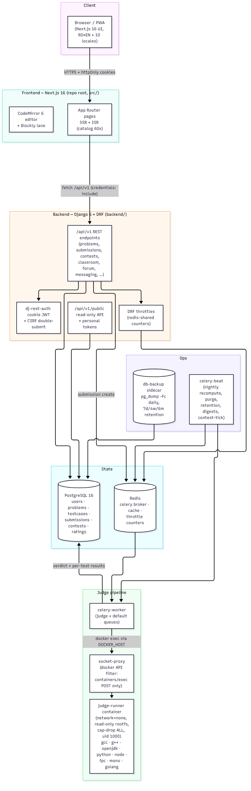
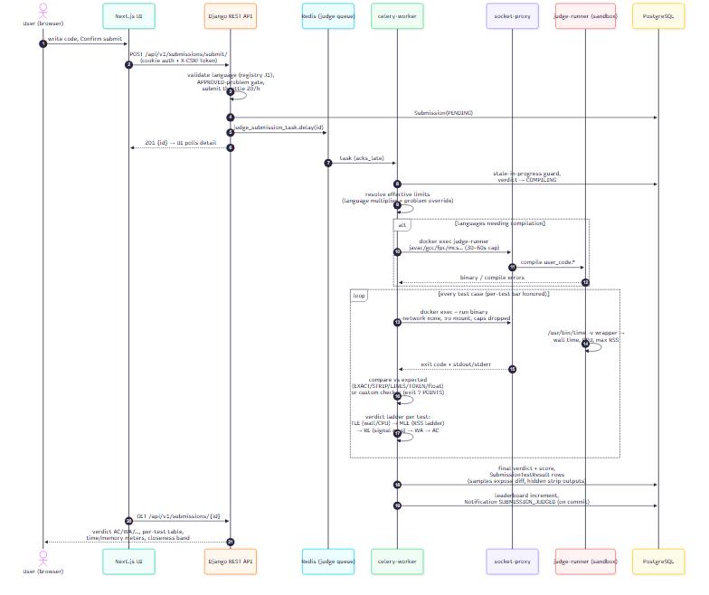
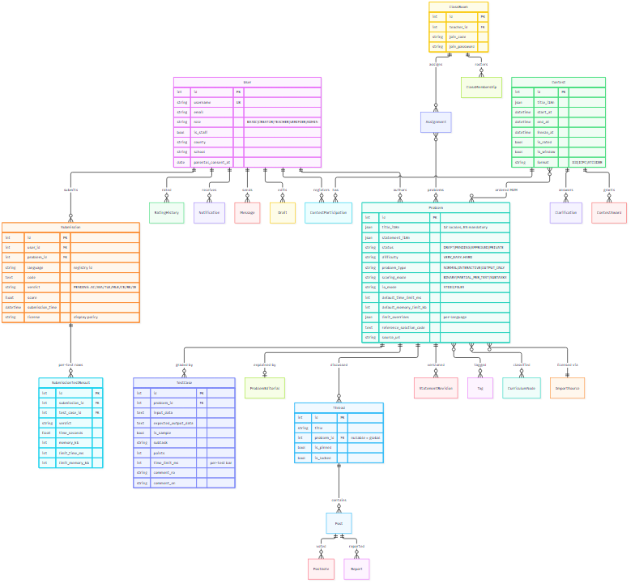
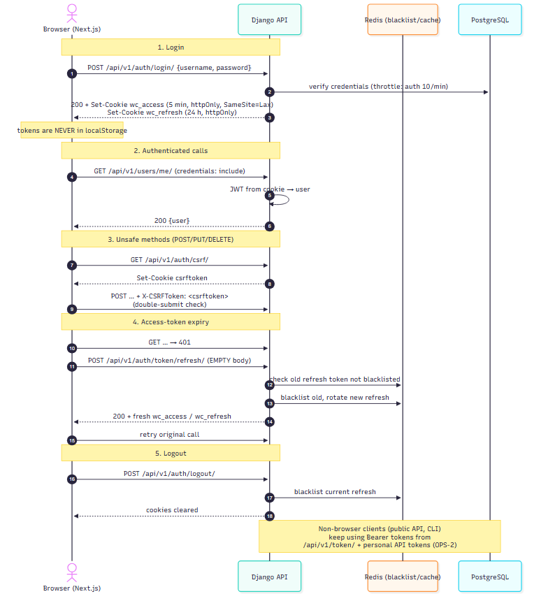
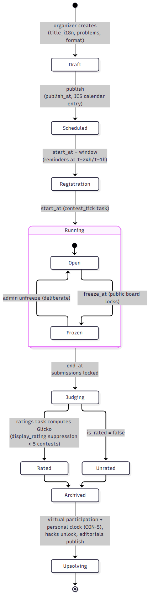

# WebCoder — Arhitectura sistemului

> Rezumat într-un paragraf: WebCoder este o platformă bilingvă (RO/EN + încă 10 limbi de interfață) de programare competitivă — un front-end Next.js 16 peste un API Django 6 / DRF, un evaluator (judge) pe Celery care execută cod neverificat într-un sandbox Docker întărit, printr-un socket-proxy de filtrare, și un strat de stare Postgres+Redis. Ghidul este pentru inginerii care trebuie să înțeleagă, să ruleze sau să extindă sistemul; fiecare secțiune se leagă de cod pe care îl poți deschide azi.

**Cui se adresează:** contributori de backend/frontend, operatori care deployază stack-ul și oricine evaluează designul platformei. Perechea în engleză: [`docs/guide-en/ARCHITECTURE.md`](../guide-en/ARCHITECTURE.md).

---

## 1. Harta componentelor



*Sursa: [`docs/diagrams/component-map.mmd`](../diagrams/component-map.mmd)*

| Componentă | Unde | Responsabilitate |
|---|---|---|
| Aplicația Next.js 16 | rădăcina repo-ului `src/`, App Router | pagini SSR/ISR, editoarele CodeMirror/Blockly, UI RO/EN cu i18next + câmpuri de problemă pe 12 limbi |
| Django 6 + DRF | `backend/` (~25 aplicații) | REST `/api/v1`: probleme, submissions, concursuri, ratinguri, clasă, forum, mesagerie, traduceri, API public |
| PostgreSQL 16 | compose `postgres` | sistemul de referință (fără port publicat pe host) |
| Redis | compose `redis` | broker celery, cache de throttle, coada judge |
| celery-worker | compose `celery-worker` | cozile judge + default; `acks_late` cu garda anti-blocaj |
| judge-runner | `backend/Dockerfile.judge` | toolchain-uri sandboxate: gcc/g++, OpenJDK, CPython, Node, fpc, mono, golang |
| socket-proxy | overlay-ul implicit compose | filtru API docker — doar containers/exec POST; restul 403 |
| celery-beat | compose `celery-beat` | recompute noaptea clasamentului, purgare notificări, retenție outputuri, digest săptămânal, `contest-tick` pe minut |
| db-backup | sidecar compose | `pg_dump -Fc` zilnic, retenție 7z/4s/6l |

Contractul frontend–backend: cookie-urile merg cu `credentials: 'include'`; lista catalogului e cache-uită ISR 60 s server-side (dezactivat sub `E2E_API_BASE`).

## 2. Pipeline-ul de evaluare



*Sursa: [`docs/diagrams/judge-pipeline.mmd`](../diagrams/judge-pipeline.mmd)*

Invarianți-cheie (toți enforce-ați în cod, `backend/submissions/`):

1. **Registrul de limbaje** (`submissions/judge_utils/languages.py`) e sursa unică de adevăr — comenzi de compilare/rulare, multiplicatori de timp per limbaj (ex. python ×3), praguri de memorie, pin-uri de toolchain publicate pe `/api/v1/public/languages/`.
2. **Orice rulare judecată** e `--network none` cu mount read-only al submissionului, toate capabilitățile eliminate, uid 1000.
3. **Scara verdicturilor** per test: TLE (wall vs CPU), MLE (scara max-RSS incl. exit-137 + ≥0,9×limită), RE (mesaje mapate pe semnal), WA, AC — trigger-urile de fabricare a verdicturilor au fost șterse în valul judge-fairness.
4. **Moduri de comparare**: EXACT / STRIP / LINES_STRIP / TOKEN / epsilon-zecimal, plus checker-e proprii cu protocolul parțial exit-7 `POINTS <0..1>` (compatibil testlib).
5. **Moduri de punctaj**: BINARY, PARTIAL_PER_TEST, SUBTASKS (regula DMOJ — toate testele grupului).
6. **Garanarea feedbackului**: testele demo expun input+expected pentru diff; testele ascunse stripă outputurile pentru privitorii neprivilegiați; barele de timp/memorie aplicate se persistă pe fiecare rând de rezultat.
7. **Biblioteci custom**: pip install-ul rulează într-un container one-shot pe rețeaua internă `judge-build` al cărei unic egress e un proxy allowlist PyPI pre-populat — fail-closed implicit (RUNBOOK §judge-pip-egress).

## 3. Modelul de date (felia de bază)



*Sursa: [`docs/diagrams/data-model.mmd`](../diagrams/data-model.mmd)*

Note de modelare:

- Câmpurile localizate sunt obiecte JSON cheiate pe limbă, cu **engleza obligatorie** (regula owner (b) din `problems/i18n_fields.py`); româna e limba pieței principale; valul i18n-10 a adăugat încă 10 limbi de interfață pentru enunțuri/titluri.
- `Submission` → `SubmissionTestResult` poartă verdictul, timpul, memoria per test **și limitele efectiv aplicate** (chitanțele judge-fairness).
- `Problem.reference_solution_code` alimentează hack-urile, scorul de putere al testelor și generatorul de suite ascunse (`boost_hidden_tests`).
- Proveniența importurilor (`source_url`, `source_authors`, ledger-ul `ImportSource`) înregistrează de unde a venit conținutul și în ce condiții (CNT-2).

## 4. Autentificarea și fluxul cookie-urilor



*Sursa: [`docs/diagrams/auth-cookie-flow.mmd`](../diagrams/auth-cookie-flow.mmd)*

- `wc_access` (5 min) + `wc_refresh` (24 h) sunt **cookie-uri httpOnly** — niciodată în `localStorage`; rotirea blacklistează refresh-ul vechi.
- Metodele unsafe cer header-ul CSRF double-submit (`GET /api/v1/auth/csrf/` eliberează cookie-ul).
- Clienții non-browser folosesc Bearer + token-uri API personale (API public, 60/min; cu token 240/min).
- Roluri: BASIC, CREATOR, TEACHER, VERIFIER, ADMIN; profilurile minorilor sunt ne-publice implicit (LEG-2).

## 5. Ciclul de viață al concursurilor



*Sursa: [`docs/diagrams/contest-lifecycle.mmd`](../diagrams/contest-lifecycle.mmd)*

- `contest_tick` (beat, pe minut) avancează tranzițiile; formatele sunt clase-strategie (IOI sum-of-best implicit; există ICPC penalty și stil AtCoder).
- Freeze-ul e un filtru pe scoreboard; ratingurile se comită post-concurs cu Glicko + suprimarea de afișare pentru începători (stil AtCoder).
- Upsolvingul/participarea virtuală redeschide problemele sub un ceas personal; hack-urile se deblochează după rezolvarea completă a tablei.

## 6. Mecanici transversale

- **Paginare**: toate endpoint-urile de listă folosesc paginare standard/cursor.
- **Throttle**: anon 60/min, user 240/min, `auth` 10/min, `submit` 20/h, scope-uri separate pentru scratch/guest/sample-run; contoare în redis (partajate între procese).
- **Observabilitate**: `/healthz`, `/readyz` (db+cache+broker), snapshot de metrici admin, loguri JSON (`LOG_JSON=1`).
- **Reproductibilitate**: `export_catalog` / `import_catalog` (+ snapshot ca asset de release) reconstruiesc determinist catalogul importat; `seed_problems` reconstruiește pachetul de start; `boost_hidden_tests` regenerează suite ascunse din specificații comise în repo.
- **Testare**: pytest (profil CI sqlite, 100 % acoperire de linii, zero warninguri), vitest, Playwright mock + mod real-stack (`E2E_API_BASE`).

## 7. Structura repository-ului

```text
backend/<app>/         aplicații Django (problems, submissions, contests, ratings,
                       classroom, forum, messaging, translations, …)
backend/problems/data/ specificații de conținut comise + fixture-e pentru catalog
docs/                  suita de documentație (ghiduri EN/RO, dist/)
e2e/                   specificații Playwright (mock-api + real-stack)
mobile/                shell-ul PWA (service worker, pachete offline)
scripts/               scripturi ops (load smoke, autoscale, restore drill)
src/                   aplicația Next.js 16 (App Router)
docker-compose*.yml    stack-ul Mode-A + overlay-uri (socket-proxy, custom-libs)
```

## 8. Lectură suplimentară

- RUNBOOK (`docs/RUNBOOK.md`) — variabile de mediu, stack-ul live, backupuri, modurile e2e
- SECURITATE (`SECURITATE.md`) — chitanțele sandbox-ului, throttle-urile, raportarea
- CONTRIBUIE — porțile de calitate, convențiile PR, fluxul valurilor
- PROGRAMARE PE BLOC — linia Blockly/Scratch și problemele cu cod parțial
