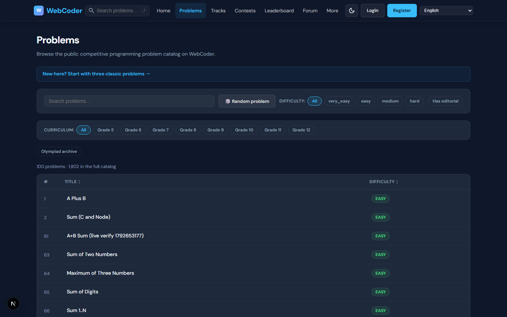
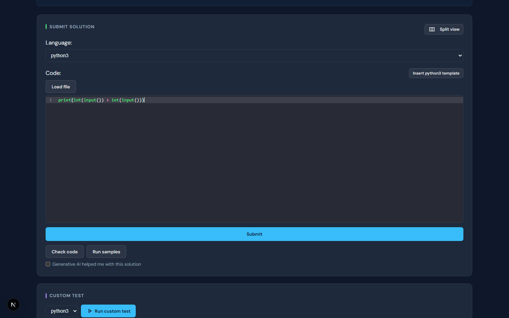
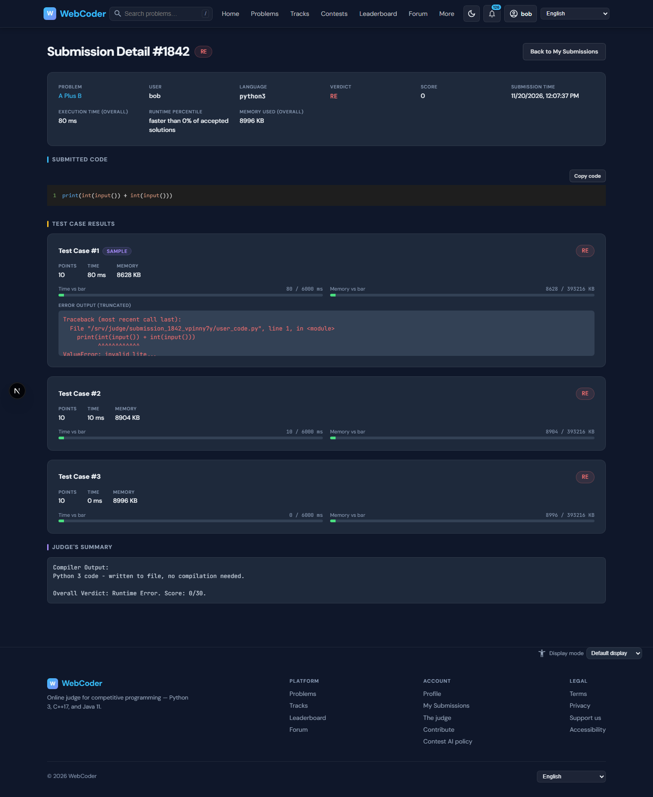

# WebCoder — Ghidul utilizatorului (elevi)

> Rezumat într-un paragraf: WebCoder este o platformă bilingvă (română/engleză + încă 10 limbi de interfață) de programare competitivă: răsfoiești ~1 800 de probleme mapate pe programa națională, le rezolvi într-un editor real cu verdicte evaluate instant, participi la concursuri cu rating, urci scara ratingului, înveți din indicii și editoriale și — cu un profesor — faci toate astea ca teme de clasă. Ghidul parcurge fiecare flux de elev de la cap la coadă.

**Cui se adresează:** elevi, concurenți, autodidacți. Perechea în engleză: [`docs/guide-en/USER-GUIDE.md`](../guide-en/USER-GUIDE.md).

---

## 1. Creează un cont

1. Deschide site-ul și apasă **Înregistrare**.
2. Alege un utilizator și o parolă (emailul e opțional, exceptând cazul în care profesorul tău cere verificare; funcționează și login cu Google / GitHub / contul școlar Microsoft).
3. Atât — ajungi pe pagina principală, cu catalogul, concursurile și hub-ul de învățare la un click distanță.

Conturi sub 16 ani (GDPR Art. 8): profilurile rămân ne-publice, iar câmpurile de județ/școală ascunse până la înregistrarea consimțământului parental; conturile de clasă pot fi mediate de școală.

## 2. Găsește o problemă

Catalogul **Probleme** (`/problems`) e suprafața principală:

- filtre pe dificultate (foarte ușor → greu), tag, capitol de curriculum (arborele claselor 5–12), arhivă-sursă, mod I/O, status rezolvat;
- **paleta Ctrl-K** caută probleme, discuții, articole, concursuri și utilizatori de oriunde;
- butonul cu zarul alege o problemă aleatorie care respectă filtrele;
- catalogul afișează contoarele de rezolvări și marcajele tale de rezolvat/încercat.

Vederea curriculum: alege clasa → capitolul → subiectul; fiecare nod își listează problemele (navigație în stil pbinfo, bilingv).

## 3. Citește, rezolvă, trimite

Pagina problemei are enunțul (Markdown + formule LaTeX), limitele, exemplele cu butoane de copiere și comentarii localizate, indiciile și editorul.

1. Alege limbajul — C, C++, Python 3, Java, JavaScript, Go, C#, Pascal (anumite probleme pot restricționa lista).
2. Scrie codul în editorul CodeMirror (Tab indentează, Ctrl+Enter trimite; ciorna se salvează automat per problemă și te urmărește pe toate device-urile).
3. Opțional înainte de trimitere: **Test custom** (rulare pe inputul tău), **Rulează exemplele** (compilează o dată, evaluează fiecare exemplu cu indicii de mismatch), **lint-ul** pre-submit (avertismente bilingve de capcane) și runner-ul de stres pentru authori.
4. Apasă **Trimite** și confirmă — pagina de verdicte face polling la evaluator și arată tabelul per test, indicatorii de timp/memorie față de barele reale și banda „cât de aproape sunt".

 

Verdicte: **AC** (acceptat), **WA** (răspuns greșit — exemplele arată diff-ul expected-vs-obținut), **TLE/MLE** (timp/memorie, cu limita aplicată), **RE** (eroare de rulare, cu semnalul explicat), **CE** (eroare de compilare, cu explicații pe înțelesul elevilor). Punctajul e parțial per test sau per subtask, după problemă.

După un AC: editorialul se deblochează (dacă e restricționat), pool-ul de soluții îți permite compararea codului tău cu cele mai rapide/scurte soluții acceptate, și poți partaja un „solve card".

## 4. Învață, nu doar puncta

- **Indicii** — progresivi, per problemă; digest-ul săptămânal trimite pe email problemele tale încercate-nerezolvate cu primul indiciu.
- **Editoriale** — se deblochează la AC-ul tău (privirea dinainte marchează rezolvarea „cu editorial").
- **/learning** — coadă de repetare spațiată peste greșeli, graf de abilități, carduri de teorie, profil de tipare de greșeli, plan de practică săptămânal generat.
- **/drills** — set zilnic de încălzire (citește-codul, completează-linia, complexități).
- **/visualizers** — animații pas-cu-pas pentru sortări și căutare binară.
- **/courses** — lecții structurate (ex. puntea Scratch→Python).
- **/start** — scara ghidată de primă rezolvare + checklist-ul de onboarding.

## 5. Concursuri și ratinguri

- `/contests` listă concursuri viitoare (cu countdown + abonare la calendarul ICS), în desfășurare și trecute; înregistrare într-un click.
- Formate: IOI (suma maximă per problemă), penalizare ICPC, concursuri cu fereastră și ceas personal pentru clase, concursuri pe echipe, cupe școlare și long challenges.
- În timpul concursului: scoreboard live (înghețat spre final), coada de clarificări către jurizare, auto-predicție a rangului final.
- După: actualizări de rating Glicko cu benzi de culoare și divizii (promovările/coborârile sunt adnotate pe graficul tău), medalii, replay pe minut al oricărui participant și upsolving în arhivă cu feedback complet.
- Integritate: declarații de asistență-AI, detecție de multi-cont, scanări de plagiat — concursurile cu rating presupun muncă neasistată (vezi pagina de reguli RO/EN).

## 6. Comunitate

- **Forum** cu thread-uri de discuții per problemă (cu marcare spoiler în interiorul lor), wiki, bloguri, hub de articole.
- **Mesagerie** — conversații private 1:1 cu raportare, blocare și protecții de rate.
- **Hub-ul comunității** (`/amas`): niveluri de reputație, premii, AMA-uri cu medaliați, tabla de cereri de probleme.
- Butoanele de raportare sunt peste tot și alimentează coada de moderare (cu SLA).

## 7. Profil și setări

`/profile` arată statisticile, heatmap-ul pe 90 de zile, streak-urile (cadrate săptămânal), barele de abilitate per tag, graficele de rating cu adnotări, badge-uri, certificate (atestate cu UUID public de verificare) și profilul tiparelor tale de greșeli. Setări: nume/bio, județ/școală (segmente de clasament), fus orar (orele concursurilor în zona ta), frecvența digest-ului de notificări, moduri de afișare a11y (prietenos cu dislexia, contrast ridicat), temă întunecată/luminoasă.

## 8. Mobil și offline

PWA-ul se instalează pe telefon; pachetele offline de enunț („Salvează offline" pe o problemă) păstrează enunțul, limitele, exemplele și indiciile fără rețea; ciornele se sincronizează la reconectare.

## 9. Scurtături de tastatură

`Ctrl-K` paleta de comenzi · `?` harta de scurtături · `Ctrl+Enter` trimite · harta listează restul.

## 10. Când ceva nu merge

- Coada evaluatorului e lentă? `/status` arată adâncimea live a cozii și sănătatea platformei.
- Probleme de cont: resetare parolă pe email; contactează un moderator prin orice raportare.
- Bug? Categoria de suport a forumului sau tabla de cereri de probleme e locul potrivit.
